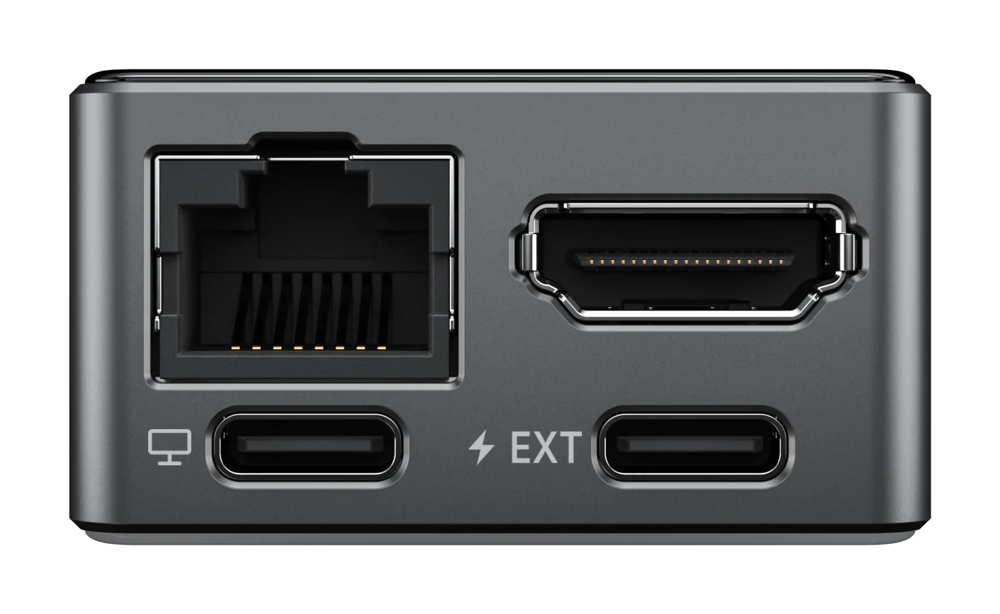
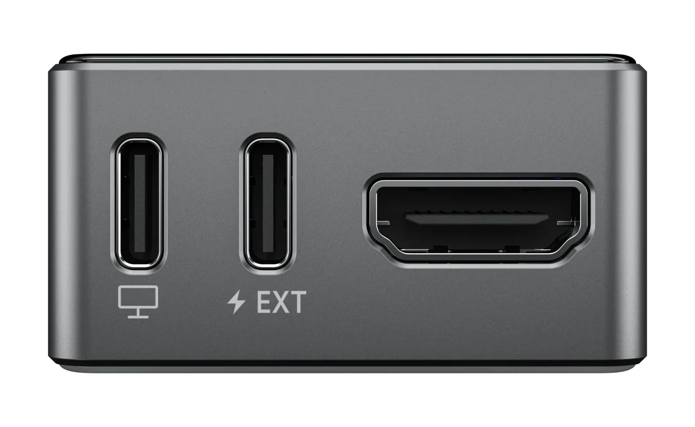

<div align="center">


Firmware for the JetKVM Mini, a KVM-over-IP device built on the ESP32-P4.

[](https://github.com/jetkvm/mini/actions/workflows/tests.yml)
[](LICENSE)

[Website](https://jetkvm.com) &bull;
[Docs](https://jetkvm.com/docs/devices/jetkvm-mini) &bull;
[Hardware](#hardware) &bull;
[Build](#build-and-flash) &bull;
[Testing](docs/testing.md) &bull;
[Security](SECURITY.md)

</div>

---

Plug the Mini into a computer's HDMI and USB ports, and control that computer from a browser: see its screen, type, click and boot it from a disk image, from anywhere on your network or through JetKVM Cloud.

## Features

- **Video and sound**: HDMI capture up to 1080p30 or 720p60 and the computer's audio, streamed to the browser over WebRTC.
- **Keyboard and mouse**: the Mini is a USB keyboard and mouse to the computer, so it works in the BIOS and before any OS starts.
- **Virtual media**: mount a disk or CD-ROM image from the TF card or from a URL, and boot the computer from it.
- **The JetKVM web UI**: the same UI as [JetKVM](https://github.com/jetkvm/kvm), served from the device.
- **Remote access**: JetKVM Cloud and Tailscale, plus MQTT for home automation.
- **OS Services**: with the OS Services companion installed on the computer, the Mini can show its desktop at higher resolutions and share a terminal, the clipboard and file drops.
- **Signed updates**: firmware updates over the air, verified against a GPG signature.

## Hardware

<table>
<tr>
<td align="center"><br><b>JetKVM Mini</b>: wired, IP101 Ethernet</td>
<td align="center"><br><b>JetKVM Mini W</b>: Wi-Fi, an ESP32-C5 over SDIO</td>
</tr>
</table>

Both have a full-size HDMI input (TC358743, up to 1080p30 or 720p60), a 240×240 display and a TF card slot. The USB-C port marked with a monitor goes to the computer for keyboard, mouse and virtual media; the EXT port takes power or an extension. Either port can power the Mini. See [hardware variants](docs/hardware-variants.md) for wiring and Wi-Fi setup, and the [JetKVM Mini docs](https://jetkvm.com/docs/devices/jetkvm-mini) for using it.

## Build and flash

Requires [ESP-IDF 6.0.2](https://docs.espressif.com/projects/esp-idf/en/v6.0.2/esp32p4/get-started/) and Node.js 22.

Build the web UI:

```sh
cd frontend/jetkvm-ui
HUSKY=0 npm ci
npm run build:device -- --outDir dist-p4
cd ../..
```

Build and flash the firmware for your variant:

```sh
# Ethernet
idf.py -B build-ethernet -DJETKVM_BOARD_VARIANT=ethernet build
idf.py -B build-ethernet -p /dev/ttyACM0 flash monitor

# Wi-Fi
idf.py -B build-wifi -DJETKVM_BOARD_VARIANT=wifi build
idf.py -B build-wifi -p /dev/ttyACM0 flash monitor
```

Once it boots, open the address shown on the device's display in a browser.

## Tests

```sh
tools/run_all_tests.sh
```

Runs the host tests after `idf.py reconfigure`. See [testing](docs/testing.md) for the device test suites.

## License

JetKVM's code is licensed under [MIT](LICENSE). Third-party notices are in
[THIRD_PARTY_NOTICES.md](THIRD_PARTY_NOTICES.md).
